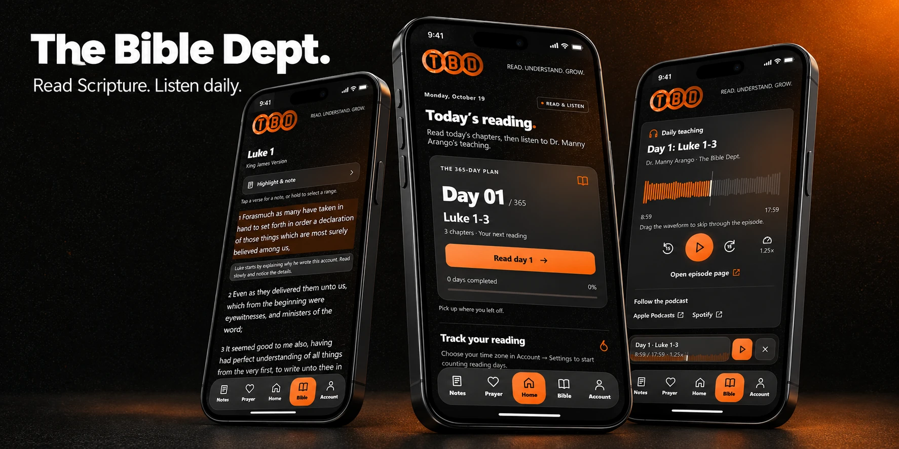
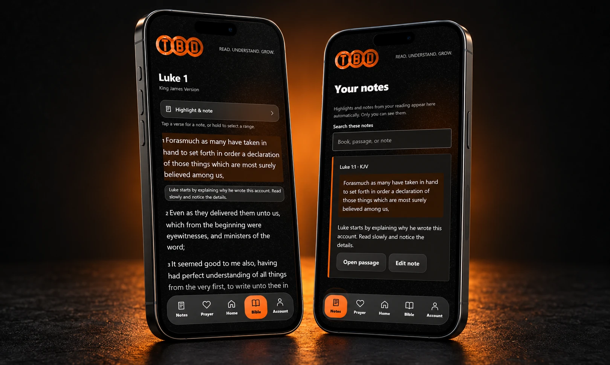
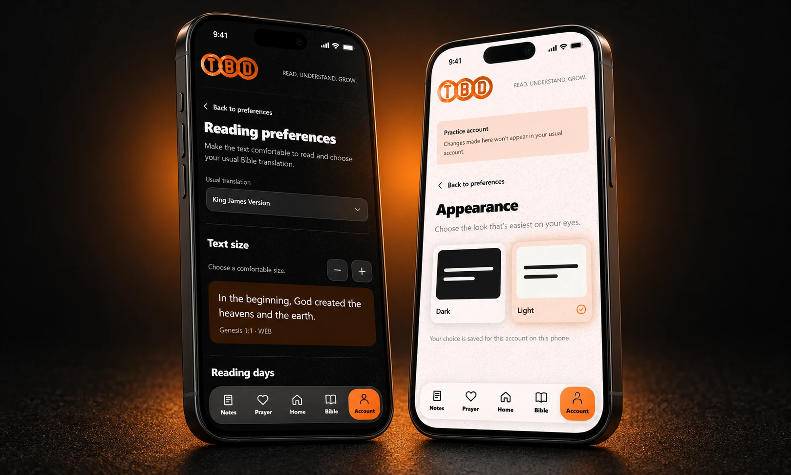

# The Bible Department

**Read Scripture. Listen daily. Keep your notes close.**

BibleDept follows [The Bible Dept.](https://www.thebibledept.com/) reading plan, pairing each day’s Scripture with teaching from Dr. Manny Arango. Open your current day, read its chapters, and listen to the corresponding episode. Save passages you want to revisit, write a private note or prayer, and return to your place when you come back.

The active app is **[bibledept-mobile](bibledept-mobile/)**: an Expo client for iPhone, Android, and web using the Firebase JavaScript SDK. It has no giving, checkout, subscriptions, or payment SDKs.

These are real captures from the running web preview and a fictional local demo account, presented in rendered iPhone mockups. They are not photographs of a signed native build. [Original captures and image details](docs/images/README.md).

## Your next reading

- **365 days mapped from the printed plan.** The compact 5.1 KB passage map lives inside the app, rather than in a cloud collection.
- **Start on Day 1.** Home makes the current reading prominent. A numbered picker, completion markers, and direct day entry let you browse without losing your place.
- **An optional Day 0.** Listen to the publisher's full introduction before starting. It has no assigned reading and does not change the 365-day count.
- **Pick up where you stopped.** Signed-in plan position and completed days sync across devices. Chapter and scroll position stay on the device, scoped to the guest or signed-in account.
- **Finish the whole lesson.** Reading each chapter and genuinely listening completes the day and opens a congratulations message. The last two minutes of audio are optional; seeking does not earn listening credit. Manual next-day continuation remains available.

## Scripture and the notes beside it

Choose a book, chapter, and verse from dropdowns. Chapters follow the selected book; verse choices come from the actual loaded passage. Translation and text-size preferences are remembered.

Tap a verse to reveal a note shortcut, or hold/select a range. Choose a highlight color and add a comment. The same private record appears in Notes automatically, where you can search, edit, delete, or reopen its passage.

**Available translations:** World English Bible (WEB) and King James Version (KJV), streamed on demand from bible-api.com. **NIV is pending licensed access.** It is not offered or silently replaced with another text. The [NIV setup checklist](docs/NIV_SETUP.md) explains how to connect it and make it the default when access is available. [Current API format and limits](docs/BIBLE_API.md).

## The teaching for each day

All 365 readings have their corresponding official podcast episode, alongside the full introductory Day 000. Audio streams directly from the publisher's RedCircle MP3 endpoints. The episode index and compact waveform samples stay in the app; audio is not bundled or downloaded just to draw a waveform.

- Genuine measured bars remain visible when paused, with foreground live response on supported platforms.
- Orange progress, an eased recent-bar indicator, a backward trail confined to the bars, and quieter gray future bars in the full player.
- Waveform seeking, compact fifteen-second skips, and 1×, 1.25×, 1.5×, and 2× speeds behind an expanding speed control.
- One player across pages. The frosted mini-player retains its orange waveform and returns to the correct daily or introductory player.
- Eased mini-player fade/blur entry and exit, with reduced-motion alternatives.
- Episode, Apple Podcasts, and Spotify links.

[Podcast sources, mapping differences, waveform data, and playback details](docs/PODCASTS.md).

## Your account and preferences

Email/password accounts support registration, sign-in, recovery, profile-name changes, and email confirmation. Account has styled profile, reading-progress, appearance, reading-preference, and reminder pages with eased transitions and usable back navigation.

- **Progress:** synced current plan day and completed lessons, saved chapter history, and a 12-week orange activity calendar with a total-day count and current streak. Consecutive days brighten gradually with a capped gold glow. Chapter reading checks and account streak credits have separate purposes.
- **Notes and prayers:** owner-private records under /bibledeptUsers/{uid}; notes stay connected to Scripture, and saved prayers can be marked answered.
- **Reading preferences:** usual translation, text size with a preview, and a confirmed reading time zone.
- **Appearance:** dark and light themes with shared orange, grain, circular light, and frosted controls.
- **Reminders:** optional reading times, AM/PM pickers, quiet hours, missed-day/return choices, and pause/off controls. Delivery remains disabled until release setup is completed.

Phone verification and app-link routing are implemented with the native/hosting prerequisites documented below. The active client has no social-login flow.

## Run locally

Start with [Local iPhone testing](docs/LOCAL_TESTING.md). From bibledept-mobile:

~~~sh
npm ci
npm --prefix functions ci
npx expo login --browser
npm start
~~~

Use Expo Go matching this SDK 57 project, sign in with the same Expo account as the CLI, connect the iPhone and Windows computer to the same Wi-Fi, and scan the terminal QR code. npm run web opens the browser client.

Firebase configuration belongs in the ignored .env.local. Documented emulator mode always selects demo-bibledept, keeping it separate from the church production project. Never commit service-account credentials or a private Scripture API key.

## Current checks and release boundaries

The October 19 review passed **101 unit tests, TypeScript, and fresh web/iOS/Android JavaScript exports**. Browser checks covered 320/390 px layouts, header wrapping, interrupted navigation, dropdown ranges, real demo-account saves, Notes sync, appearance, time-zone setup, prayers, and daily/intro audio controls. [Complete request checklist](docs/REQUEST_CHECKLIST.md) · [Optimization evidence](docs/REQUEST_AUDIT.md).

| Area | Current state |
| --- | --- |
| NIV default | Waiting for licensed access; [setup plan](docs/NIV_SETUP.md) ready. |
| Locked/background audio | Actual iPhone Expo Go tests still stop playback. Further work was explicitly deferred. Force quitting iOS stops playback. |
| Offline Bible downloads | Explicitly postponed. |
| Directional page motion blur | The earlier effect was removed after regressions; native lateral blur is not implemented. The mini-player's separate fade/blur is implemented. |
| Native release validation | Physical glass/touch/large-text/VoiceOver checks, signed phone auth and push setup, public website association, and intended-project backend deployment still need release verification. Exports do not establish these. |
| Required sign-in and onboarding | Requested [launch plans](docs/launch/README.md) are drafted and discoverable, **not activated**. The present preview permits guest reading/listening. |

## Implementation and launch references

| Guide | Covers |
| --- | --- |
| [Launch plans](docs/launch/README.md) | Mandatory sign-in and first-time onboarding drafts, prerequisites, tests, and rollout. |
| [Request checklist](docs/REQUEST_CHECKLIST.md) | Every request, completed work, blocked/deferred items, and release checks. |
| [Optimization audit](docs/REQUEST_AUDIT.md) | Rendering, loading, regressions, measured tradeoffs, and verification. |
| [Style and taste guide](docs/style-guide/README.md) | Bible Dept/ARMA visual and copy references, including the illustrated PDF. |
| [Design implementation](docs/APP_DESIGN_IMPLEMENTATION.md) | App-specific design, navigation, glass, motion, and voice decisions. |
| [Backend setup](docs/HABIT_FEATURES_SETUP.md) | Owner records, reading-day ledger, reminders, migration, and deployment. |
| [Signed iPhone setup](docs/IPHONE_NATIVE_SETUP.md) | Native builds, phone verification, and device prerequisites. |
| [App links](docs/APP_LINKS.md) | Passage routes and website association requirements. |

## Repository layout

| Directory | Role |
| --- | --- |
| bibledept-mobile | Active free Expo client. |
| bibledept-mobile/functions | Reading-day, migration, reminder, device-binding, and account-cleanup backend. |
| bibledept-app | Retained older native app for migration reference. |
| bibledept-dashboard | Retained administration dashboard. |
| bibledept-functions | Retained older backend. |

Retained projects contain additional community, chat, study-plan, organization, and content-processing capabilities. They are not claimed as implemented in the Expo client. Historical vendor package names and attribution remain in that source; legacy payment code is excluded from the active free app.

## Sources and license

[The Bible Dept.](https://www.thebibledept.com/) · [Reading plan](https://www.thebibledept.com/plan) · [Listen](https://www.thebibledept.com/listen) · [Start Here](https://www.thebibledept.com/start-here)

Application source: [MIT license](LICENSE.md). Scripture, podcast, website, and brand materials retain their respective rights and attribution.
